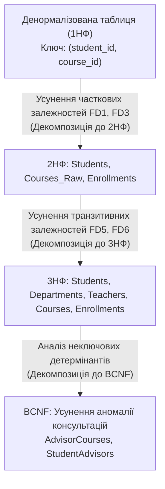

# Практична робота №12. Нормалізація реляційних таблиць до 3НФ і BCNF

**Предмет:** Бази даних  | **Група:** ІПЗ-41  | **Виконала:** Єва Якимчук

---

## 1. Мета роботи
Навчитися формально визначати функціональні залежності (ФЗ) предметної області, виявляти аномалії модифікації, здійснювати поетапну декомпозицію універсального відношення до третьої нормальної форми (3НФ) та нормальної форми Бойса-Кодда (BCNF), перевіряти властивості безвтратності з'єднання (Lossless Join) і збереження залежностей (Dependency Preservation).

---

## 2. Вихідне денормалізоване відношення
Розглянемо зведене відношення обліку навчання студентів у коледжі `UnnormalizedCollegeRegistry`:

$$R(\underline{\text{student\_id}}, \text{student\_name}, \text{group\_code}, \text{student\_email}, \underline{\text{course\_id}}, \text{course\_code}, \text{course\_title}, \text{credits}, \text{tuition\_fee},$$
$$\text{department\_id}, \text{department\_code}, \text{department\_name}, \text{head\_of\_department},$$
$$\text{teacher\_id}, \text{teacher\_name}, \text{teacher\_email}, \text{enrolled\_on}, \text{status}, \text{grade})$$

### Кандидатні ключі:
Основним складеним ключем відношення $R$ є пара:
$$K = \{\text{student\_id}, \text{course\_id}\}$$
(студент може бути зареєстрований на певний курс лише один раз). Альтернативним ключем є $\{\text{student\_email}, \text{course\_code}\}$.

---

## 3. Карта функціональних залежностей (FD)

| Позначення | Функціональна залежність | Тип залежності від ключа |
|---|---|---|
| **$FD_1$** | $\{\text{student\_id}\} \to \{\text{student\_name}, \text{group\_code}, \text{student\_email}\}$ | **Часткова залежність** (залежить лише від частини складеного ключа) |
| **$FD_2$** | $\{\text{student\_email}\} \to \{\text{student\_id}, \text{student\_name}, \text{group\_code}\}$ | Альтернативний ключ сутності «Студент» |
| **$FD_3$** | $\{\text{course\_id}\} \to \{\text{course\_code}, \text{course\_title}, \text{credits}, \text{tuition\_fee}, \text{department\_id}, \text{teacher\_id}\}$ | **Часткова залежність** (залежить лише від частини складеного ключа) |
| **$FD_4$** | $\{\text{course\_code}\} \to \{\text{course\_id}, \text{course\_title}, \text{credits}, \text{tuition\_fee}, \text{department\_id}, \text{teacher\_id}\}$ | Альтернативний ключ сутності «Курс» |
| **$FD_5$** | $\{\text{department\_id}\} \to \{\text{department\_code}, \text{department\_name}, \text{head\_of\_department}\}$ | **Транзитивна залежність** ($\text{course\_id} \to \text{department\_id} \to \dots$) |
| **$FD_6$** | $\{\text{teacher\_id}\} \to \{\text{teacher\_name}, \text{teacher\_email}, \text{department\_id}\}$ | **Транзитивна залежність** ($\text{course\_id} \to \text{teacher\_id} \to \dots$) |
| **$FD_7$** | $\{\text{student\_id}, \text{course\_id}\} \to \{\text{enrolled\_on}, \text{status}, \text{grade}\}$ | **Повна функціональна залежність** від усього ключа |

---

## 4. Поетапна декомпозиція

### 1) 1НФ $\to$ 2НФ (Усунення часткових залежностей)
* **Порушення 2НФ:** Атрибути студента залежать лише від `student_id`, а атрибути курсу, кафедри та викладача — лише від `course_id`. Це порушує вимогу 2НФ: *усі неключові атрибути мають повно функціонально залежати від усього складеного ключа*.
* **Крок декомпозиції:** виділяємо відношення за лівими частинами часткових залежностей:
  1. `Students`($\underline{\text{student\_id}}$, student\_name, group\_code, student\_email). Ключ: `student_id`.
  2. `Courses_Interm`($\underline{\text{course\_id}}$, course\_code, course\_title, credits, tuition\_fee, department\_id, department\_code, department\_name, head\_of\_department, teacher\_id, teacher\_name, teacher\_email). Ключ: `course_id`.
  3. `Enrollments`($\underline{\text{student\_id}}, \underline{\text{course\_id}}$, enrolled\_on, status, grade). Ключ: $\{\text{student\_id}, \text{course\_id}\}$.

### 2) 2НФ $\to$ 3НФ (Усунення транзитивних залежностей)
* **Порушення 3НФ:** У відношенні `Courses_Interm` існують залежності:
  $$\text{course\_id} \to \text{department\_id} \quad \text{і} \quad \text{department\_id} \to \{\text{department\_code}, \text{department\_name}, \text{head\_of\_department}\}$$
  $$\text{course\_id} \to \text{teacher\_id} \quad \text{і} \quad \text{teacher\_id} \to \{\text{teacher\_name}, \text{teacher\_email}\}$$
  Оскільки `department_id` та `teacher_id` не є суперключами для `Courses_Interm`, атрибути кафедри та викладача транзитивно залежать від первинного ключа `course_id`.
* **Крок декомпозиції:**
  1. `Departments`($\underline{\text{department\_id}}$, code, name, head\_of\_department).
  2. `Teachers`($\underline{\text{teacher\_id}}$, department\_id, full\_name, email).
  3. `Courses`($\underline{\text{course\_id}}$, department\_id, code, title, credits, tuition\_fee).
  4. `Students` та `Enrollments` переходять без змін.

### 3) 3НФ $\to$ BCNF (Нормальна форма Бойса-Кодда)
Відношення знаходиться в **BCNF**, якщо в будь-якій нетривіальній функціональній залежності $X \to Y$ детермінант $X$ є **суперключем**.

* **Аналіз основного набору таблиць:** У всіх створених таблицях (`Departments`, `Teachers`, `Courses`, `Students`, `Enrollments`) кожна ліва частина функціональної залежності є первинним або унікальним ключем. Отже, ці таблиці вже перебувають у BCNF.
* **Граничний випадок 3НФ, що не є BCNF (Керівництво проєктами):**
  Розглянемо додаткове відношення:
  $$\text{ProjectAdvisory}(\underline{\text{student\_id}}, \underline{\text{course\_id}}, \text{advisor\_id})$$
  * **Правила предметної області:**
    1. Для кожного курсу студента призначається один викладач-консультант: $\{\text{student\_id}, \text{course\_id}\} \to \text{advisor\_id}$.
    2. Кожен консультант закріплений суворо за одним конкретним курсом: $\text{advisor\_id} \to \text{course\_id}$.
    3. Консультант може вести багатьох студентів.
  * **Кандидатні ключі:** $K_1 = \{\text{student\_id}, \text{course\_id}\}$ та $K_2 = \{\text{student\_id}, \text{advisor\_id}\}$.
  * **Перевірка 3НФ:** У залежності $\text{advisor\_id} \to \text{course\_id}$ правий атрибут `course_id` є первинним (входить до складу кандидата $K_1$). Згідно з визначенням 3НФ, це дозволено! Таблиця знаходиться в 3НФ.
  * **Перевірка BCNF:** У тій самій залежності $\text{advisor\_id} \to \text{course\_id}$ детермінант `advisor_id` **НЕ є суперключем** (він не визначає студента). Отже, BCNF порушено!
  * **Декомпозиція до BCNF:**
    1. `AdvisorCourses`($\underline{\text{advisor\_id}}$, teacher\_id, course\_id) — детермінант `advisor_id` стає первинним ключем!
    2. `StudentAdvisors`($\underline{\text{student\_id}}, \underline{\text{advisor\_id}}$).
  * **Безвтратність:** Перетин схем — `advisor_id`, що є ключем першої таблиці. За теоремою Хіта розклад є безвтратним (Lossless Join).

---

## 5. Демонстрація усунення аномалій

| Тип аномалії | Прояв у денормалізованій схемі | Поведінка в нормалізованій схемі (3НФ/BCNF) |
|---|---|---|
| **Аномалія вставки (Insertion Anomaly)** | Неможливо додати нову кафедру чи курс, доки на нього не зареєструється хоча б один студент (бо `student_id` є частиною первинного ключа і не може бути `NULL`). | Нова кафедра додається напряму в таблицю `departments`, курс — у `courses`, незалежно від наявності студентів. |
| **Аномалія оновлення (Update Anomaly)** | Якщо завідувач кафедри ІТ змінився, необхідно оновити ПІБ у десятках рядків усіх зареєстрованих студентів. Пропуск одного рядка призводить до суперечливості даних. | Оновлення виконується єдиним запитом `UPDATE college_normalized.departments SET head_of_department = ... WHERE department_id = 10;`. |
| **Аномалія видалення (Deletion Anomaly)** | Якщо єдиний студент, що вивчав «Астрономію», відраховується, видалення запису призводить до повної втрати інформації про курс та кафедру. | Видаляється лише рядок із `enrollments`. Запис про курс залишається в таблиці `courses`. |

---

## 6. Відповіді на питання для захисту

1. **У чому різниця між 3НФ і BCNF?**
   У 3НФ функціональна залежність $X \to A$ допускається, якщо або $X$ є суперключем, або залежний атрибут $A$ є первинним (входить до складу будь-якого кандидатного ключа). BCNF є суворішою формою: вона вимагає, щоб для **будь-якої** нетривіальної функціональної залежності $X \to Y$ її детермінант $X$ був виключно суперключем, без будь-яких послаблень для первинних атрибутів.

2. **Що таке неключовий детермінант?**
   Це атрибут або група атрибутів $X$, від яких функціонально залежать інші атрибути ($X \to Y$), проте сам $X$ не є суперключем відношення (тобто не може однозначно ідентифікувати кортеж таблиці). Наявність неключового детермінанта свідчить про транзитивну залежність (порушення 3НФ) або порушення BCNF.

3. **Коли декомпозиція може втратити залежність?**
   Втрата залежності (loss of dependency preservation) виникає тоді, коли у вихідному відношенні існує залежність $X \to Y$, але після розбиття таблиці на $R_1$ і $R_2$ атрибути $X$ і $Y$ опиняються в різних таблицях. Перевірити таке обмеження стає неможливо за допомогою простих `PRIMARY KEY` чи `UNIQUE` на рівні однієї таблиці, і для збереження цілісності доводиться створювати складні міжтабличні тригери або матеріалізовані представлення.

4. **Як перевірити, що декомпозиція безвтратна?**
   Для декомпозиції відношення $R$ на два відношення $R_1$ та $R_2$ безвтратність з'єднання (Lossless Join) перевіряється за **теоремою Хіта (Heath's Theorem)**: перетин атрибутів $R_1 \cap R_2$ повинен бути суперключем хоча б для одного з отриманих відношень:
   $$(R_1 \cap R_2) \to R_1 \quad \text{або} \quad (R_1 \cap R_2) \to R_2$$
   Для довільної кількості таблиць використовується формальний **алгоритм Чейза (Chase test)** за допомогою таблиці булевих позначок.

---

## 7. Висновок
У роботі детально розглянуто теорію нормалізації реляційних структур. Побудовано граф і карту функціональних залежностей для схеми коледжу. Виконано покрокову декомпозицію від вихідної надлишкової таблиці 1НФ через 2НФ і 3НФ до BCNF. Доведено відсутність аномалій модифікації та збереження цілісності за допомогою зовнішніх ключів у файлі `normalization.sql`.
