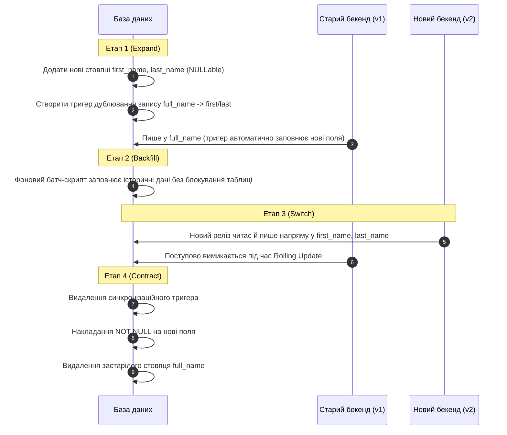

# Практична робота №14. Версіонування схем і міграції

**Предмет:** Бази даних  | **Група:** ІПЗ-41  | **Виконала:** Єва Якимчук

---

## 1. Мета роботи
Опанувати концепцію Database Migration-as-Code: навчитися проєктувати, фіксувати у версійному репозиторії, послідовно застосовувати та документувати зміни структури реляційної бази даних (DDL), формувати зворотні кроки (Rollback/Undo), вести журнал версій та розбивати складні блокуючі зміни на безпечні фази без простою сервісу (Zero-Downtime Migrations).

---

## 2. Структура файлів міграцій

Усі скрипти організовано відповідно до промислового стандарту **Flyway**:

```
Практична 14/
├── migrations/
│   ├── V1__init.sql                 # Початкова схема: departments, courses, students, enrollments
│   ├── V2__add_teacher_id.sql       # Додавання teachers та обов'язкового FK teacher_id до courses
│   ├── V3__drop_status.sql          # Заміна поля status на completed_at у таблиці enrollments
│   ├── U2__revert_add_teacher_id.sql # Зворотний відкат міграції V2
│   └── U3__revert_drop_status.sql   # Зворотний відкат міграції V3
├── migrate.sql                      # Симулятор runner-у міграцій з журналом schema_history
└── README.md
```

---

## 3. Опис виконаних міграцій та зворотних кроків

### Міграція V1 (`V1__init.sql`)
* **Мета:** Створення базової схеми `college`, 4 реляційних таблиць (`departments`, `courses`, `students`, `enrollments`) та внесення початкових демонстраційних записів.
* **Зворотний крок:** `DROP SCHEMA college CASCADE;`.

### Міграція V2 (`V2__add_teacher_id.sql`)
* **Проблема:** Неможливо однією командою `ALTER TABLE courses ADD COLUMN teacher_id INTEGER NOT NULL REFERENCES ...` змінити непорожню таблицю, оскільки наявні рядки отримають `NULL` і викличуть помилку порушення обмеження `23502 (not_null_violation)`.
* **Багатоетапний безпечний алгоритм:**
  1. Створити таблицю `college.teachers`.
  2. Додати викладачів, включно з черговим викладачем за замовчуванням (fallback).
  3. Додати стовпець `teacher_id` як **NULLABLE**.
  4. Виконати бекфіл (Backfill): оновити наявні курси ідентифікаторами викладачів.
  5. Встановити обмеження `NOT NULL` на стовпець `courses.teacher_id`.
  6. Накласти обмеження зовнішнього ключа `fk_courses_teacher`.
* **Зворотний крок (`U2__revert_add_teacher_id.sql`):** видалення зовнішнього ключа $\to$ видалення стовпця `courses.teacher_id` $\to$ видалення таблиці `teachers`.

### Міграція V3 (`V3__drop_status.sql`)
* **Мета:** Вилучення застарілого статусу `status` на користь явної дати `completed_at`.
* **Кроки:** Додати поле `completed_at` $\to$ перенести дату для завершених курсів $\to$ зняти обмеження `CHECK` $\to$ видалити стовпець `status`.
* **Зворотний крок (`U3__revert_drop_status.sql`):** відновлення стовпця `status` $\to$ заповнення значень за умовою `completed_at IS NOT NULL` $\to$ відновлення `CHECK (status IN (...))` $\to$ видалення `completed_at`.

---

## 4. Журнал застосування міграцій (`schema_history`)

У скрипті `migrate.sql` реалізовано повноцінний версійний механізм. Журнал фіксує порядок застосування, хеш-суму файлу, автора та тривалість виконання:

| installed_rank | version | description | script | checksum | execution_time_ms | success |
|:---:|:---:|---|---|:---:|:---:|:---:|
| 1 | 1.0 | init schema and core tables | V1__init.sql | a1b2c3d4e5f6 | 18 | true |
| 2 | 2.0 | add teachers table and teacher_id to courses | V2__add_teacher_id.sql | f6e5d4c3b2a1 | 12 | true |
| 3 | 3.0 | drop status and add completed_at in enrollments | V3__drop_status.sql | c3b2a1f6e5d4 | 8 | true |

### Демонстрація ідемпотентності та захисту від повторного запуску
При спробі повторного виклику версії `2.0` runner перевіряє наявність запису у `schema_history`:
```
NOTICE:  >>> Пропуск міграції 2.0 (add teachers table and teacher_id to courses): версія вже успішно застосована.
```
Це гарантує безпеку під час автоматизованого деплою в CI/CD пайплайнах.

---

## 5. Сценарій складної міграції без простою (Zero-Downtime: Expand and Contract)

### Проблема:
Необхідно перейменувати стовпець `full_name` у таблиці `students` на `student_name` або розділити його на `first_name` та `last_name` у таблиці на 10 мільйонів рядків під активним навантаженням (24/7 Production).
Одномоментний `ALTER TABLE ... RENAME COLUMN` призведе до падіння старої версії додатку, яка все ще звертається за назвою `full_name`.

### Рішення через патерн «Розширення та звуження» (Expand and Contract):



1. **Фаза Expand (Розширення):**
   * Створюються нові поля `first_name` та `last_name` як дозволені до `NULL`.
   * Встановлюється тригер, який при змінах від старого коду автоматично розщеплює рядок і дублює значення в нові поля.
2. **Фаза Backfill (Заповнення):**
   * Фоновий процес пачками по $1000$ рядків оновлює наявні історичні записи, не блокуючи таблицю.
3. **Фаза Switch (Перемикання коду):**
   * Додаток оновлюється версією v2, яка починає читати й писати в нові стовпці.
4. **Фаза Contract (Звуження):**
   * Після повного виведення з експлуатації старої версії додатку видаляється синхронізаційний тригер, нові поля робляться `NOT NULL`, а старий стовпець `full_name` видаляється.

---

## 6. Відповіді на питання для захисту

1. **Чому міграції зберігають у репозиторії разом із кодом?**
   Структура бази даних нерозривно пов'язана з бізнес-логікою додатку. Зберігання міграцій у Git гарантує синхронізацію: кожна гілка або реліз коду містить точний набір змін DDL, необхідний для його роботи. Це забезпечує відтворюваність середовищ (Local, Staging, Production), можливість code review змін схеми та автоматизацію деплою через CI/CD.

2. **Що таке зворотна міграція і коли вона потрібна?**
   Зворотна міграція (Down/Undo migration) — це сценарій, який скасовує зміни, внесені відповідною прямою міграцією (Up), повертаючи схему до попереднього стабільного стану. Вона потрібна в разі аварійного відкату невдалого релізу (Rollback) на стендах розробки та тестування, або коли виявлено критичну несумісність.

3. **Як міграції допомагають узгодити схеми у різних командах?**
   Завдяки чіткій версійній нумерації та таблиці історії міграцій розробники можуть паралельно вносити зміни. При злитті гілок (Merge) система контролю версій виявляє конфлікти міграцій, а інструмент виконання (Flyway/Liquibase) контролює послідовність накладання патчів, запобігаючи ручним неконтрольованим змінам схеми.

4. **Чому зміну `NOT NULL` на таблиці з даними складно зробити одним кроком?**
   Якщо таблиця містить мільйони рядків, прямий виклик `ALTER TABLE ... ALTER COLUMN ... SET NOT NULL` змушує СКБД сканувати всю таблицю для перевірки відсутності `NULL`, захоплюючи блокування виключного доступу `ACCESS EXCLUSIVE`. Це паралізує всі читання та записи до таблиці. Крім того, за наявності хоча б одного `NULL` транзакція зазнає аварійної невдачі, тому спочатку потрібен аудит, заповнення дефолтними даними (Backfill) і лише після цього безпечне додавання обмеження.

---

## 7. Висновок
У ході практичної роботи опановано методологію версіонування структури баз даних за стандартом Flyway. Створено міграції `V1`, `V2`, `V3` та відповідні відкатні файли `U2`, `U3`. Реалізовано і протестовано SQL-симулятор обліку версій у таблиці `schema_history`, описано технологію міграцій без простою сервісу (Zero-Downtime Expand-Contract).
